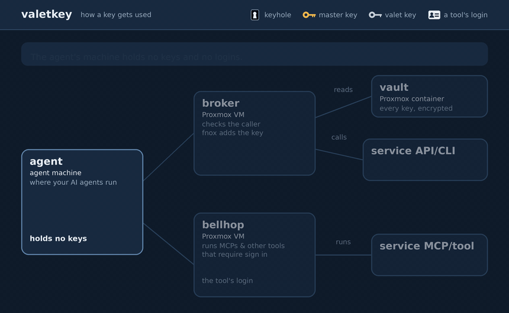

<p align="center">
  
</p>

<h1 align="center">valetkey</h1>

<p align="center">
  <b>Your machines get a valet key, never the master.</b><br>
  A self-hosted way to let AI agents use your API keys and logins without ever holding them:<br>
  a credential broker and a tool desk on their own machines, joined over your private network.
</p>

<p align="center">
  
  
  
  
  
</p>

<p align="center">
  <a href="#installation"><b>Install</b></a> ·
  <a href="#one-command-per-machine">One command per machine</a> ·
  <a href="bellhop/README.md">bellhop</a> ·
  <a href="docs/secure-setup.md">Secure setup</a>
</p>

<br>

<p align="center">
  
  <br>
  <sub>The agent's machine holds no keys. The broker adds a key to a request on its way out; the desk runs tools that keep their own login.</sub>
</p>

> [!IMPORTANT]
> **This is not a bulletproof solution for protecting keys from agents.** It is a practical way to reduce the risk in a home agentic setup, where you run AI agents on your own machines. It stops a key being read and copied from an agent's machine. It does not stop an agent misusing the access it is given, it depends on you keeping the machines separate, and it has had no outside security review. If you have compliance requirements, many users or keys whose loss you could not absorb, use it as a starting point and not as your only control. [Security model](#security-model) lists what it does and does not cover.

> [!WARNING]
> **For a private tailnet only. Never expose any part of it to the internet.** valetkey is not built for a public-facing system: the broker, the desk and the vault must be reachable only from your own machines over Tailscale. **You use it at your own risk**: it comes with no warranty, and the author is not responsible for any loss or damage. Read [Use at your own risk](#use-at-your-own-risk) before installing.

<br>

<table>
  <tr>
    <td width="25%" valign="top">
      <h3>🔑 No keys on agent machines</h3>
      An agent calls the broker with no key. The broker adds it on the way out. There is nothing on the agent's machine to read, print or copy.
    </td>
    <td width="25%" valign="top">
      <h3>🛎️ A desk for tools that sign in</h3>
      bellhop runs command-line tools that keep their own login on a separate machine. Agents use them by name and get the output, never the login.
    </td>
    <td width="25%" valign="top">
      <h3>🧱 Containment first</h3>
      Every part has its own machine and one installer. The network policy tests itself on each save, and the guide says plainly what is not separate enough.
    </td>
    <td width="25%" valign="top">
      <h3>🙋 You stay in charge</h3>
      Agents ask for keys and tools by name. You type the value or install the tool. Who may use what changes only at a console.
    </td>
  </tr>
</table>

## Contents

- [What it is](#what-it-is)
- [Features](#features)
- [Installation](#installation): [requirements](#requirements), [one command per machine](#one-command-per-machine)
- [The parts and where each runs](#the-parts-and-where-each-runs)
- [Why](#why)
- [How it works](#how-it-works)
- [Containment: where everything runs](#containment-where-everything-runs)
- [Getting started](#getting-started): the full setup, step by step
- [Everyday use](#everyday-use)
- [Configuration](#configuration)
- [Commands](#commands)
- [Security model](#security-model)
- [Tailscale: what valetkey relies on](#tailscale-what-valetkey-relies-on)
- [The desk: tools with their own login](#the-desk-tools-with-their-own-login)
- [Working with AI agents](#working-with-ai-agents)
- [What it costs: tokens and time](#what-it-costs-tokens-and-time)
- [Upgrading](#upgrading)
- [Troubleshooting](#troubleshooting)
- [Project layout](#project-layout)
- [Development](#development)
- [Use at your own risk](#use-at-your-own-risk)
- [Status and license](#status-and-license)

## What it is

valetkey is a self-hosted credential broker. It pairs [Vaultwarden](https://github.com/dani-garcia/vaultwarden) and [fnox](https://fnox.jdx.dev) with two parts of its own, **relay** and **bellhop**, over [Tailscale](https://tailscale.com). relay is the broker service: it checks which machine is calling and adds the key, so agents call broker API routes without holding one; separate trusted services can opt into raw credentials. bellhop does the same for command-line tools and MCP servers that keep their own login: they run on a separate desk machine, and agents use them by name without ever holding the login.

A valet key starts the car but won't open the trunk. valetkey gives each machine the same kind of key: it can use the few credentials its routes allow, for as long as it is on your tailnet, and nothing else. The master key stays in one place: a small broker VM that is the only thing allowed to unlock the vault.

Software alone does not keep a key from an agent. **Where each part runs matters as much as what it does.** Read [Containment](#containment-where-everything-runs) before installing anything, then follow [secure setup](docs/secure-setup.md). Never run agents on the broker, the desk, the vault server, an owner entry device, a trusted raw-value consumer or their management host. Raw reads are denied by default; existing deployments need the migration steps in that guide before upgrading.

## Features

- **No agent-side provider key required.** Approved broker API routes inject keys remotely. Existing credentials and Tailscale machine state still need protection. Revoke route access in `routes.toml` or the tailnet policy.
- **Key injection.** `[api.*]` routes add credentials to outgoing HTTPS calls (exact host, methods and path prefixes) through `fnox proxy`. The calling process never has the key.
- **Works with fnox as is.** Uses fnox's own `vault` provider with a 100-line shim. Keep `fnox exec`, profiles and `if_missing = "error"`.
- **Broker-only agent policy.** Agent nodes can check and request; raw reads require a separate trusted-consumer grant. Includes offline guidance for agent memory.
- **Owner entry, two ways.** Hidden terminal prompt (`vault-entry`) or a plain, phone-friendly web page that only your devices can submit to.
- **Replace with backup.** Each replace keeps `<name>-backup-YYYYMMDD`; same-day collisions are refused. Backups require the same trusted raw-consumer policy as the original.
  fnox may find multiple items when a backup contains the original name. The owner must resolve that ambiguity privately before restarting the route; agents must not delete backups. `relay-check` and `relay-routes install` report it.
- **Upstream 401/403 detection.** An API route that starts failing marks its item *may be expired*. You see the mark next to a one-click replace.
- **Least privilege on the broker.** Separate system users, separate Vaultwarden accounts, view-only read accounts, a write account unlocked for seconds at a time, and hardened systemd units (`ProtectSystem=strict`, `NoNewPrivileges`, and more).
- **Names only, everywhere.** Audit logs, checks, errors and installer output contain item names and `ok` / `FAIL`, never values.
- **No runtime dependencies beyond the tools.** Python standard library only. The broker needs `bw`, `fnox`, `jq` and `tailscale`, and `install.sh broker --with-deps` installs them.
- **A desk for tools with their own login.** bellhop runs listed subcommands of a command-line tool on a separate machine and returns the output. Login and token subcommands, risky options and paths into the desk are refused. Files travel with the command.
- **Install requests, not installs.** An agent asked to add a tool that needs a login files a request; the owner installs it. Nothing an agent sends makes the desk install or run anything new.
- **Checks on the agent machine.** A root-owned policy can limit MCP servers to the broker and desk, and an hourly sweep reports logins and new tools by name.
- **One-command installs** for all three parts: `install.sh vaultwarden`, `install.sh broker --with-deps` and `install.sh client --with-deps` bring their own Docker, Tailscale, Bitwarden CLI and fnox. Proxmox scripts can create the Vaultwarden container and the broker VM from scratch.

---

## Installation

Every machine installs with the same command, on Linux and on macOS. Open a terminal on that
machine and run:

```sh
curl -fsSL https://raw.githubusercontent.com/machinarii/valetkey/main/install.sh | bash
```

It asks one question, which machine this is, and does the rest:

- It lists only the roles that fit this computer: all seven on Linux, three on a Mac (a Mac is
  only ever a client). On a Proxmox host it suggests "Proxmox host".
- It fills in your tailnet's broker and desk addresses from Tailscale; press Enter to accept them.
- It asks for `sudo` only for the steps that need root.
- Before it changes Claude Code or Codex settings, it says what it will change and why, and asks.
- It never asks for a key or password.

| On this machine | Choose | What happens |
|---|---|---|
| **Proxmox host** (Linux) | Proxmox host | Creates the vault container and the broker and desk VMs, and installs each one. Replaces the next three rows. |
| **Vault host** (Linux) | Vault host | Docker, Tailscale and Vaultwarden, reachable only on the tailnet. |
| **Broker** (Linux VM) | Broker | Tailscale, the Bitwarden CLI, fnox and the relay services. |
| **Desk** (Linux VM, optional) | Desk | The desk service and its front door. No tools or logins yet. |
| **Agent machine** (Linux) | Agent machine | `relay` and `bellhop` in agent mode, the hourly sweep, the Claude Code policy (asked first), then the agent rules for Claude Code and Codex. Asks for the desk address and which desk tools to link. |
| **Agent machine** (Mac) | Agent machine | `relay` in agent mode in `~/.local/bin`, no root, then the agent rules for Claude Code and Codex. |
| **Owner device** (Linux or Mac) | Owner device | `relay` and `vault-entry`, the hidden prompt for typing keys. A phone or tablet needs nothing installed: use the entry page in its browser. |
| **Trusted consumer** (Linux or Mac) | Trusted consumer | `relay`, the `vault` shim and fnox. |

Read [Containment](#containment-where-everything-runs) first: which machine each part runs on is
what keeps the keys away from agents. Never pick two roles on one machine.

### Client tools with Homebrew (macOS and Linux)

The client tools are also Homebrew packages, one per role, on macOS and on Linux with Homebrew:

```sh
brew tap machinarii/valetkey https://github.com/machinarii/valetkey
brew trust machinarii/valetkey      # Homebrew asks you to trust a third-party tap once
brew install valetkey-agent       # agent machine: relay only
brew install valetkey-owner       # owner device: relay and vault-entry
brew install valetkey-consumer    # trusted consumer: relay and the vault shim (add fnox)
relay set-url https://broker.<tailnet>.ts.net
```

They use the `python3` already on the machine (3.9 or newer). The three packages refuse to install side by side, because one machine has one role.
`brew upgrade` keeps them current. On Linux, Homebrew may first install its own compiler and C library (a few hundred MB); the installer above needs neither. On a Linux agent machine, the installer above still does more
than the package: the desk stand-in, the sweep and the Claude Code policy. `./install.sh claude`
adds the agent rules to Claude Code and Codex in either case.

**No access to GitHub on that machine, or prefer to read the code first?** Clone the repository,
or copy it over, and run the same menu from the copy:

```sh
git clone https://github.com/machinarii/valetkey && cd valetkey && ./install.sh
# from another computer: git archive HEAD | ssh <machine> 'mkdir -p valetkey && tar -x -C valetkey'
```

The installer fetches the code with git, or with curl when git is missing, into a temporary
folder that it deletes afterwards. `VALETKEY_REF=<tag or branch>` before `bash` installs that
version instead of `main`. The commands behind each choice are under
[One command per machine](#one-command-per-machine).

Set the machines up in this order. [Getting started](#getting-started) has every step:

1. [Prepare the tailnet](#1-prepare-the-tailnet)
2. [Run Vaultwarden](#2-run-vaultwarden) on the vault host
3. [Create the accounts and organizations](#3-create-the-accounts-and-organizations)
4. [Install the broker](#4-install-the-broker)
5. [Log the relays in](#5-log-the-relays-in)
6. [Set up the machines that use keys](#6-set-up-the-machines-that-use-keys): agent machines, owner devices, trusted consumers
7. [Wire up a project](#7-wire-up-a-project)
8. [Add the desk](#8-add-the-desk-optional) (optional)
9. [Verify](#9-verify)

Already installed? See [Upgrading](#upgrading).

### Requirements

| Where | Needs |
|---|---|
| **Tailnet** | Tailscale with MagicDNS and HTTPS Certificates turned on. You need admin access to edit the ACL. |
| **Vaultwarden** | Any host with Docker (the Proxmox LXC script is optional). Vaultwarden 1.37.2+ for current Bitwarden clients. |
| **Broker** | Debian 12+ or Ubuntu 24.04+ with systemd ≥ 250, Python ≥ 3.11 and a TPM or vTPM (for `systemd-creds`). 2 vCPU, 2 GB RAM and 8 GB disk. Each relay runs the Bitwarden CLI, which is heavy: 1 GB runs out once an org has more than a few `[api.*]` routes. |
| **Desk** (optional) | Debian 12+ or Ubuntu 24.04+ with systemd and Python ≥ 3.11, on its own VM. 2 vCPU, 2 GB RAM and 16 GB disk is enough for a few tools. No TPM needed. |
| **Clients** | Python ≥ 3.9 (macOS's `/usr/bin/python3` works), Tailscale, and [fnox](https://fnox.jdx.dev) for project pulls (`install.sh client --with-deps` installs both). |

### One command per machine

Each machine gets exactly one installer. Run it on that machine, from a copy of this repository. `./install.sh` with no arguments asks which machine this is and runs the right row for you.

| Machine | Command | What it installs |
|---|---|---|
| **Hypervisor** (Proxmox) | `sudo ./install.sh proxmox [--no-desk]`<br>(runs `deploy/proxmox/vaultwarden-ct.sh`, `deploy/proxmox/broker-vm.sh` and `bellhop/proxmox-desk-vm.sh`) | Creates the vault container and the broker and desk VMs, and runs the three installers below inside them |
| **Vault host** | `sudo ./install.sh vaultwarden` | Docker, Tailscale, Vaultwarden published on the tailnet only |
| **Broker** | `sudo ./install.sh broker --with-deps` | Tailscale, Bitwarden CLI, fnox, the relay services and broker tools |
| **Desk** (optional) | `sudo ./install.sh desk` | Tailscale, the desk service, the TLS front door. No tools, no logins |
| **Agent machine** | `sudo ./install.sh agent --relay-url … --desk-url … --tools …`<br>`./install.sh claude` | `relay` in agent mode, the `bellhop` stand-in, the sweep and its timer, a policy that limits MCP servers to the broker and desk (it says why and asks first). Then, as the agent's user, the rules in `CLAUDE.md` (and Codex's `AGENTS.md`, if Codex is installed) and the blocks you choose in Claude Code's settings. No keys |
| **Owner device** | `./install.sh client --owner --relay-url …` | `relay` and `vault-entry` |
| **Trusted consumer** | `./install.sh client --relay-url … --with-deps` | `relay`, the `vault` shim, fnox |

Never combine two rows on one machine, with one exception: the hypervisor hosts the vault, broker and desk as separate guests. If you use Proxmox, the first row replaces the next three.

What no installer can do for you, because each step is a decision or a secret:

- edit the tailnet policy in the Tailscale admin console;
- create the Vaultwarden accounts and organizations, and type their passwords;
- sign the relays in (`relay-login`) and sign tools in on the desk;
- write the routes and the desk's tool list: who may use what;
- take `sudo` away from the agent's user.

---

## The parts and where each runs

valetkey is several small tools, each with one job, and each belongs on a particular machine. The machines are separate on purpose; see [Containment](#containment-where-everything-runs).

| Part | What it is for | Runs on |
|---|---|---|
| **Tailscale** | The private network between your machines. It gives every machine a name the broker and desk can check, issues the HTTPS certificates, and holds the policy that says who may reach whom. | Every machine |
| **Vaultwarden** | The vault. Stores every key, encrypted. You manage it with the Bitwarden apps. Only the broker and your own devices can reach it. | Vault host |
| **relay** | The broker's services. They stand between your machines and the vault: unlock it, hand out only what each machine's routes allow, add keys to outgoing API calls, and take new keys from you. | Broker |
| &nbsp;&nbsp;`relay-front` | The only listener: HTTPS on the broker's tailnet address. Passes each request to a service below and tells it which machine is calling. | Broker |
| &nbsp;&nbsp;`relay-local`, `relay-infra` | The read side, one per vault organization: checks, values for trusted consumers, API routes. | Broker |
| &nbsp;&nbsp;`relay-entry` | The write side: named requests from agents, and the page and prompt where you type a value. | Broker |
| **fnox** | On the broker, adds the key to an outgoing API call (`fnox proxy`). On a trusted consumer, starts a program with its secrets (`fnox exec`). | Broker; trusted consumers |
| **Broker tools** `relay-login`, `relay-check`, `relay-routes`, `relay-update` | Sign the relays in to the vault, check them, apply route changes, update the broker. | Broker, at its console |
| **`relay`** | The client. Asks the broker whether a key exists and requests a new one by name. Never shows a value. | Agent machines and every other client |
| **`vault`** | A small shim that lets fnox fetch a value from the broker for a trusted program. | Trusted consumers only |
| **`vault-entry`** | A hidden prompt for typing a key's value. | Owner devices only |
| **bellhop desk** | Runs command-line tools that keep their own login, on behalf of agent machines, within a list you write. | Desk |
| **`bellhop`** | The stand-in. Sends a command and its files to the desk and returns the output. Linked under each tool's own name. | Agent machines |
| **sweep** | An hourly check that no login and no unexpected tool has appeared. Reports names only. | Agent machines, as root |
| **Agent rules** | Standing instructions that tell an agent how to ask for keys and tools, and what never to do. | Agent machines |
| **Proxmox scripts** | Create the vault container and the broker and desk VMs, then run the right installer in each. | Hypervisor |

---

## Why

Secrets tend to spread across a fleet: an `.env.local` on the dev box, a key in the laptop's Keychain, an age-encrypted file with its private key next to it, a token pasted into a VM's systemd unit. Every copy is one more place to leak from. Once AI agents run on those machines, every copy is also something an agent can read and repeat back into a chat transcript.

Two things can go wrong with an agent that holds a key, and valetkey reduces the risk of both:

- **The agent goes wrong on its own.** It misreads a task, takes a shortcut or acts on a bad guess, and does something harmful: prints a key into a transcript, commits it, or uses it somewhere it was never meant for.
- **Someone else steers the agent.** A web page, a document, a package or a tool result carries hidden instructions (prompt injection), and the agent follows an attacker's orders instead of yours.

In both cases an agent with no key has nothing to hand over, and it can reach only the routes, operations and tools you listed for its machine. This lowers the risk; it does not remove it. An agent can still misuse whatever access you did give it, as [What containment does not do](#what-containment-does-not-do) explains.

Password managers solve storage. They don't solve *use*: to use a key a process needs the value, so the value ends up on the machine. Secret managers built for that (Vault, Infisical, Doppler) bring tokens of their own, and a token on a client is just another secret to protect.

valetkey takes a different route:

| Problem | valetkey's answer |
|---|---|
| Keys copied onto every machine | Agent machines receive no raw provider key through approved API routes. Separate trusted consumers fetch only what their processes need. Existing secret files are not removed by Valet. |
| Broker client tokens to protect and rotate | **Identity is the machine.** The broker asks Tailscale who is calling (`tailscale whois`). There is no additional Valet bearer token; Tailscale identity still needs protecting. |
| Agents that can read and print secrets | Declared agent machines use API routes and cannot read raw values. `relay check` reports storage/access status, not upstream authentication. |
| Pasting a new key into chat | The owner types the value into a **hidden terminal prompt or a web page on the tailnet**. The agent picks the name, so naming can't drift. |
| A key that silently expired | **Replace with backup**: the old value is kept as `<name>-backup-YYYYMMDD`. Only trusted consumers/operators may use backups. |

---

## How it works

```
 laptop / devbox / bots                    broker VM                                   Vaultwarden
┌─────────────────────────┐  tailnet     ┌──────────────────────────────────────┐    ┌─────────────┐
│ fnox exec -- npm start  │  HTTPS       │ relay-front  :443 (Tailscale cert)    │    │             │
│   └ vault shim ─────────┼────────────▶ │   /local  → relay-local  127.0.0.1:8441 ──▶│ local-org   │
│ relay check / request   │              │   /infra  → relay-infra  127.0.0.1:8442 ──▶│ infra-org   │
│ curl …/local/stripe/v1  │              │   /entry  → relay-entry  127.0.0.1:8443 ──▶│ (writes)    │
└─────────────────────────┘              └──────────────────────────────────────┘    └─────────────┘
 identity = Tailscale machine name         each relay: own Linux user, own Vaultwarden
 nothing stored on the client              account, own encrypted unlock, own audit log
```

**The vault.** Vaultwarden, published only on the tailnet with `tailscale serve`. Keys are sorted into two organizations by *where they are used*:

- **`local`**: your own machines and network (home lab, personal tools, push URLs).
- **`infra`**: deployed and cloud services, with one nested collection per project (`infra-broker-collection/shop`).

**The broker.** One small Linux VM, and the only machine that unlocks a vault. It runs four systemd services, each as its own system user:

| Service | Vault access | Does |
|---|---|---|
| `relay-front` | none | TLS on the broker's Tailscale address, port 443. Routes `/local`, `/infra` and `/entry` to the loopback services and stamps each request with the caller's tailnet IP. |
| `relay-local` | reads `local-org` (view-only account) | Serves `local` values, checks and API routes. |
| `relay-infra` | reads `infra-org` (view-only account) | The same for `infra`. |
| `relay-entry` | writes both (edit account) | Creates and replaces items, only when the owner submits a value. Unlocks for one write, then locks again. |

Each unlock password is stored with `systemd-creds`, encrypted to the VM's TPM/vTPM and host key. Read relays keep a decrypted item cache in broker memory that refreshes every 5 minutes, and immediately after every write.

**Who may use what.** `/etc/relay/routes.toml` on the broker lists, per credential, which Tailscale machines (`nodes`) may use it. There are three kinds of route:

| Route | The caller gets | Use it for |
|---|---|---|
| `[api.<route>]` | The upstream response. The broker forwards the call and `fnox proxy` injects the key for that host, those methods and those paths. | Reviewed HTTPS endpoints that cannot return credentials. |
| `[project.<name>]` | Values of that project's items, read through fnox at process start. | Apps you run with `fnox exec`. |
| `[value.<name>]` | One raw value. | Things that must hold the value themselves: SSH keys, push URLs, database URLs. |

An unknown caller (not a tailnet peer) gets `403`. A tailnet machine that isn't listed gets `not-allowed`. There is no endpoint that lists the vault.

`[security].agent_nodes` declares broker-only machines. Raw routes additionally require
`[security].trusted_value_nodes` membership (empty by default). Agent/raw and agent/owner role
conflicts are rejected. The fnox pull examples below are for separate trusted consumers only.

**Three flows.**

1. **Pull.** A project's `fnox.toml` points fnox's `vault` provider at the broker. fnox runs the `vault` shim for each secret, the shim does one HTTPS GET, and the value goes into the process's environment and nowhere else. `fnox exec -- npm run dev` works as before.
2. **Inject.** A client calls `https://broker.<tailnet>.ts.net/local/stripe-shop/v1/…` with no key. The broker adds the key on the way out. The client never holds it.
3. **Entry.** An agent runs `relay request stripe-api-key-shop-prod --org infra --project shop --purpose "…"`. You enter the value with `vault-entry <id>` in your private terminal or on `https://broker.<tailnet>.ts.net/entry`, on a separate owner device. The broker writes it, verifies it and tells the agent `stored`; the response contains no value.

**The desk (optional).** Some tools cannot go through an API route: a command-line tool that signs in and keeps its own login file, for example. bellhop puts those on a second small VM, the desk. The agent machine has a stand-in command under the tool's name; it sends the command and any files to the desk, which runs the real tool with its own login and returns the output. See [The desk](#the-desk-tools-with-their-own-login).

More detail: [docs/architecture.md](docs/architecture.md).

---

## Containment: where everything runs

The rule is short: **a key lives only on a machine where no agent runs, and an agent machine holds no key.** Everything below follows from it. The broker and the desk identify a caller by its machine, not by the program that is calling, so every process on a machine shares that machine's access. An agent and a key on the same machine means the agent can reach the key, whatever the software says.

### The machines

| Machine | Holds | Runs agents | Reachable by |
|---|---|---|---|
| **Agent machine** (dev box, bot, CI runner) | No key, no login, no vault session | Yes | Nothing needs to reach it |
| **Broker** | Vault unlock material; keys in memory | Never | Agent machines and owner devices, port 443 only |
| **Desk** (optional) | Logins of the command-line tools it runs | Never | Agent machines, port 443 only |
| **Vault** (Vaultwarden) | The encrypted vault | Never | The broker and owner devices, port 443 only |
| **Owner device** (your laptop, phone) | What you type during entry | Never | Nothing |
| **Trusted consumer** (a deployed service) | Only the keys its own process needs | Never | Its own application port |
| **Hypervisor** | Control of every VM on it | Never | You, at its console |

### Recommended layout

```
 separate hardware                          one hypervisor host (Proxmox VE)
┌──────────────────────┐   tailnet 443    ┌───────────────────────────────────────────┐
│ agent machines       │ ───────────────▶ │ VM   broker    vTPM, 2 vCPU, 2 GB         │──┐
│  no keys, no sudo,   │ ───────────────▶ │ VM   desk      2 vCPU, 2 GB  (optional)   │  │ 443
│  sandboxed commands  │                  │ LXC  vault     Vaultwarden in Docker      │◀─┘
└──────────────────────┘                  └───────────────────────────────────────────┘
┌──────────────────────┐   tailnet 443            ▲ console or LAN SSH only
│ owner devices        │ ───▶ vault, broker       │
└──────────────────────┘                    you, never an agent
```

- **Put the broker, the desk and the vault on a hypervisor that no agent can administer.** A small always-on box running [Proxmox VE](https://www.proxmox.com/proxmox-virtual-environment) is the tested path: `deploy/proxmox/` and `bellhop/proxmox-desk-vm.sh` create all three from scratch.
- **Keep agent machines on different hardware**, or at least on a different hypervisor. An agent that controls a hypervisor controls every VM on it.
- **Give each of the three its own VM or container.** The broker gets a VM because it needs a virtual TPM. Run nothing else on any of them.
- **Manage the broker and the desk from the hypervisor's console or LAN SSH.** Nothing reaches them over SSH on the tailnet, and there is no remote or automatic update trigger.

### What counts as separate

| Arrangement | Good enough? |
|---|---|
| Different physical machines | Yes. The strongest option |
| VMs on a dedicated hypervisor that agents cannot log in to or control | Yes |
| VMs or containers created by a desktop tool on a computer that also runs agents | **No** |
| A container next to the agent, when the agent can reach the container engine | **No** |
| Another Unix user on the agent's machine | **No** |
| A rule in the agent's instructions | **No**. Useful, but not a boundary |

Desktop virtualization is built for convenience, and that convenience is the problem. Check what yours shares before trusting it. With [OrbStack](https://orbstack.dev)'s default machines, for example, each machine can read the host's home folder, see the other machines' files and run commands on the host, the host can run commands as root inside any machine, and the default user has passwordless sudo. Its isolated machines turn the file sharing and host integration off, which makes them fine for *agent* machines and for testing. They are still not a place for the broker or the desk if agents also run on that computer.

Things that quietly join two machines into one, from the agent's point of view:

- a mounted host folder or a shared volume;
- the host's Tailscale identity shared by several VMs (give each agent machine its own node);
- passwordless `sudo`, or membership of the `docker` group;
- a forwarded SSH agent, a shared clipboard, a management socket;
- backups or disk images of the broker or desk stored where an agent can read them.

### The agent machine

An agent machine is treated as readable by the agent in full. Set it up so there is nothing to read:

1. **Its own tailnet identity, tagged.** A tagged machine gets only the grants written for that tag. A personal device may inherit access meant for your own machines.
2. **No sudo for the agent's user**, and no control of its own hypervisor or host.
3. **No logins.** No `gh auth login`, no cloud CLIs signed in, no `.env` files with real keys, no SSH keys that open other machines. Git goes [through the broker](docs/git-through-the-broker.md).
4. **Sandbox the agent's commands** where the agent supports it, with network access limited to the hosts it needs. This limits accidents; it does not replace the points above.
5. **Restrict where MCP servers may live.** With Claude Code, a root-owned `/etc/claude-code/managed-settings.json` can allow only servers at the broker's or the desk's address.
6. **Watch for drift.** `bellhop/sweep.py`, run hourly as root, reports any login file, key in a settings file or newly installed program on the machine, by name only.
7. **Do not sign in to things on it yourself** out of habit. That is how logins come back.

### The network

Merge [`deploy/tailscale/acl.example.hujson`](deploy/tailscale/acl.example.hujson) into your tailnet policy. It grants exactly this and tests it on every save:

| From | To | Port |
|---|---|---|
| Agent machines | broker, desk | 443 |
| Owner devices | vault, broker | 443 |
| Broker | vault | 443 |
| Anything | broker or desk over SSH | Denied |
| Agent machines | vault, owner devices | Denied |

**Keep all of it inside the tailnet.** valetkey is not intended for a public-facing system. Do not publish the broker, the desk or the vault with Tailscale Funnel, a port forward, or a reverse proxy, tunnel or public IP address that is reachable from outside the tailnet (`tailscale serve`, which the vault setup uses, stays inside it), and do not share those machines into someone else's tailnet. The broker decides who is calling from the machine's Tailscale identity and has no other sign-in, so anything that lets outside traffic reach it removes the protection.

Grants in a tailnet policy add up, so remove any allow-all or member-to-member rule. The tailnet policy cannot close a LAN or public interface: the broker and desk listen only on their tailnet address, with their services on loopback behind it.

### Recommended tools

| Job | Tool | Why |
|---|---|---|
| Hypervisor for broker, desk and vault | Proxmox VE on its own box | VMs with a virtual TPM, containers, a console that does not depend on the tailnet; scripts included |
| Guest OS | Debian 13 (cloud image) | Current systemd for `systemd-creds`; what the scripts and tests use |
| Network and machine identity | Tailscale with MagicDNS, HTTPS certificates and tags | The broker and desk name callers with `tailscale whois`; tags keep grants narrow |
| Vault | Vaultwarden | Self-hosted, works with the Bitwarden apps and CLI |
| Key injection and project secrets | fnox | The broker's API routes use `fnox proxy`; projects keep `fnox exec` |
| Unlock material at rest | `systemd-creds` with the VM's vTPM | Encrypted to that VM; useless if the disk is copied |
| Monitoring | Any uptime monitor on its own tagged machine | Checks that the broker and desk answer; it needs port 443 and no route |
| Agent sandbox | The agent's own sandbox and policy file | Limits what a command can read and reach on the agent machine |

One command does the parts that can be automated: `sudo ./install.sh agent …` installs the clients as root-owned files the agent cannot edit, the MCP policy (point 5) and the sweep with its hourly timer (point 6). It then lists what is left for you: the tailnet identity, `sudo`, and keeping logins off the machine.

### What containment does not do

Hiding a key stops it being copied. It does not limit what an agent does with the access it is given: a route or a listed tool can be used freely by every listed machine. Keep keys narrow at the service, prefer test-mode and capped keys, and list only the operations you need. See [Security model](#security-model).

---

## Getting started

Allow about an hour for the first setup, most of it creating Vaultwarden accounts. You type every password yourself, into a hidden prompt or Vaultwarden's own web page. None of them goes into this repo, a command argument or a chat.

The table under [One command per machine](#one-command-per-machine) is the map: each step below runs on a different machine.

### 1. Prepare the tailnet

In the Tailscale admin console ([Tailscale: what valetkey relies on](#tailscale-what-valetkey-relies-on) has the documentation links):

1. **DNS:** turn on **MagicDNS** and **HTTPS Certificates**.
2. **Access controls:** merge [`deploy/tailscale/acl.example.hujson`](deploy/tailscale/acl.example.hujson) into your policy. Owner devices reach `tag:vault` and `tag:broker` on 443; workload machines reach only `tag:broker:443` (and `tag:desk:443` if you use the desk); the broker reaches `tag:vault:443`; nothing reaches the broker or desk over SSH. The `tests` block checks this every time you save.

### 2. Run Vaultwarden

**On Proxmox** (creates an unprivileged Debian LXC, installs Docker and Tailscale, publishes Vaultwarden on `https://vault.<tailnet>.ts.net`):

```sh
git clone https://github.com/machinarii/valetkey && cd valetkey
bash deploy/proxmox/vaultwarden-ct.sh          # CTID=210 STORAGE=local-lvm BRIDGE=vmbr0 by default
```

**On any other Debian/Ubuntu host, VM or container** (installs Docker and Tailscale, starts Vaultwarden on loopback and publishes it on the tailnet only):

```sh
git clone https://github.com/machinarii/valetkey && cd valetkey
sudo ./install.sh vaultwarden                  # VAULT_HOSTNAME=vault VW_VERSION=… to override
```

Open the Tailscale login URL it prints. The scripts land in `/opt/vaultwarden`.

Optionally, to enable the admin page, run `/opt/vaultwarden/set-admin-token.sh` from an interactive console. Only the Argon2 hash is stored.

### 3. Create the accounts and organizations

In the web vault, in your browser:

1. Create **your own account** and turn on two-step login.
2. Create the three **relay accounts**, each with its own long random password from your password generator. Addresses are only login names; no mail server is needed.

   | Account | Joins | Access |
   |---|---|---|
   | `…-local` | `local-org` | *Can view* on `local-broker-collection` |
   | `…-infra` | `infra-org` | *Can view* on `infra-broker-collection` **and every nested collection** |
   | `…-entry` | both | *Can edit* on both collections **and every nested collection** |

3. As yourself, create the organizations `local-org` and `infra-org` with those collections, and invite the relay accounts. Log in once as each relay account to accept, then **Confirm** each member as yourself.
4. Close sign-ups: `pct exec 210 -- /opt/vaultwarden/close-signups.sh` (or run the script inside the container).

Vaultwarden grants access per collection: a parent does not include its children. Each new project collection (`infra-broker-collection/<project>`) needs the `-infra` and `-entry` accounts granted on it, and then `sudo relay-login infra …` and `sudo relay-login entry …` run again on the broker. The relays record collection IDs at login (`/var/lib/relay-<name>/org.json`). Different org or collection names are fine; set them in `/etc/relay/vault.env` (step 4).

### 4. Install the broker

**On Proxmox** (creates a Debian 13 VM with a vTPM, copies this repo into it and installs everything):

```sh
bash deploy/proxmox/broker-vm.sh               # VMID=211 BROKER_HOSTNAME=broker by default
```

**On any Debian/Ubuntu VM with a TPM:**

```sh
git clone https://github.com/machinarii/valetkey && cd valetkey
sudo ./install.sh broker --with-deps
```

`--with-deps` installs Python, jq, Tailscale, the Bitwarden CLI and fnox (pinned version, via mise), then joins the tailnet as `broker` with `tag:broker`; open the login URL it prints. `install.sh broker` then creates the service users, installs the code to `/usr/local/libexec/relay`, writes `/etc/relay/{routes,entry}.toml` and `vault.env` from the examples, generates the loopback credential, fetches the Tailscale certificate and enables the units. It prints `ok`, `skip` or `FAIL` for each step. It is safe to re-run, and never overwrites your `/etc/relay` files.

Edit the configs for your machines (see [Configuration](#configuration)):

```sh
sudo nano /etc/relay/routes.toml   # who may use what
sudo nano /etc/relay/entry.toml    # your own devices (owner_nodes)
sudo nano /etc/relay/vault.env     # VAULT_URL and org/collection names, if not the defaults
```

### 5. Log the relays in

From a secure terminal on the broker (its console, or LAN SSH). Each command asks for that account's password at a hidden prompt:

```sh
sudo relay-login local <-local account address>
sudo relay-login infra <-infra account address>
sudo relay-login entry <-entry account address>
sudo relay-check        # expect: unlocked ×3, ok for every item and route, all units active
```

### 6. Set up the machines that use keys

**On each agent machine**, one command as root:

```sh
git clone https://github.com/machinarii/valetkey && cd valetkey
sudo ./install.sh agent --relay-url https://broker.<tailnet>.ts.net
```

It installs `relay` in agent mode, the hourly sweep and a policy that limits MCP servers to the broker, all as root-owned files, and prints what is left for you. With a desk, add `--desk-url https://desk.<tailnet>.ts.net/desk --tools tool1,tool2`; each tool name becomes a stand-in. `--user NAME` says which user the agent runs as, and `--no-policy` skips the MCP policy.

Then, as the user the agent runs as, set up Claude Code itself:

```sh
./install.sh claude
```

It asks six questions about what to block, shows the changes, and writes them only when you agree. See [Working with AI agents](#working-with-ai-agents).

**On each owner device and trusted consumer:**

```sh
git clone https://github.com/machinarii/valetkey && cd valetkey
./install.sh client --relay-url https://broker.<tailnet>.ts.net --with-deps
```

`--with-deps` installs what is missing: Tailscale (Linux; on macOS it points you to the download) and, except on agent machines, fnox at the version the broker is tested with (through [mise](https://mise.jdx.dev), linked into the prefix). Leave it off to install them yourself.

On macOS agent machines, where `install.sh agent` does not run, use `client --agent` to install only `relay` and offline guidance. On separate owner devices, add `--owner` to also get `vault-entry`; these modes cannot be combined. Tools go to `~/.local/bin` (`--prefix` to change it). For trusted consumers, that directory must come before HashiCorp `vault` on `PATH`. `./install.sh doctor` reports installation and broker reachability.

### 7. Wire up a project

On a separate trusted consumer with no agents or agent-controlled code, add the project to
`/etc/relay/routes.toml` on the broker and reload. Merge the security lists with existing policy:

```toml
[security]
agent_nodes = ["devbox"]
trusted_value_nodes = ["app-shop"]

[project.shop]
org   = "infra"
nodes = ["app-shop"]
items = ["*-shop-qa", "*-shop-prod"]
```

```sh
sudo relay-routes install
```

Point the project's `fnox.toml` at the broker. To generate it from your current `fnox list` (names only, never values):

```sh
{ fnox list; echo "== production"; fnox list -P production --no-defaults; } \
  | fnox-to-relay --project shop --env qa --org infra > fnox.toml
```

```toml
[providers.relay]
type    = "vault"
address = "https://broker.<tailnet>.ts.net/infra"   # broker URL + org
path    = "shop"                                    # project
token   = "tailscale"                               # placeholder; identity is the machine

[secrets]
DATABASE_URL = { provider = "relay", value = "database-url-shop-qa", if_missing = "error" }
TLS_KEY      = { provider = "relay", value = "tls-key-shop-qa/notes", if_missing = "error" }
```

Check every item, then run as usual:

```sh
relay check infra $(sed -n 's/.* value = "\([^"]*\)".*/\1/p' fnox.toml)    # all ok
FNOX_DAEMON=off fnox exec -- npm run dev
```

Set `FNOX_DAEMON=off` (for example in the project's `.mise.toml` `[env]`) so values aren't cached outside the process. Once it works, delete the old `.env` files and local keys yourself, and rotate them when convenient.

### 8. Add the desk (optional)

Only if agents need a command-line tool that keeps its own login. An HTTP API or an MCP server with a fixed key needs no desk: give it an `[api.*]` route on the broker.

**On Proxmox** (creates a Debian 13 VM and installs the desk in it):

```sh
bash bellhop/proxmox-desk-vm.sh                # VMID=212 DESK_HOSTNAME=desk by default
```

**On any Debian/Ubuntu VM that runs nothing else:**

```sh
git clone https://github.com/machinarii/valetkey && cd valetkey
sudo ./install.sh desk
```

Add `tag:desk` to the tailnet policy first; the installer joins the tailnet with that tag and prints a login URL. It installs no tool and no login. [bellhop/README.md](bellhop/README.md) covers listing tools, signing them in and the stand-in command for agent machines.

### 9. Verify

From a client:

```sh
curl -fsS https://vault.<tailnet>.ts.net/alive                          # owner devices only
curl -fsS "https://broker.<tailnet>.ts.net/local/check?names=x"         # {"x": "not-allowed"} or "missing"
```

From a device that isn't on the tailnet, both should fail. On the broker, `sudo relay-check` should show `unlocked` ×3 and `ok` everywhere.

---

## Everyday use

**Is an authorized item present?** This does not test upstream authentication.

```sh
relay check infra stripe-api-key-shop-prod pgpassword-shop-qa
# ok  stripe-api-key-shop-prod
# missing  pgpassword-shop-qa
```

**Add a key (agent or you).** Name it `<key>-<project>-<env>` (`dev|qa|prod`), or `<key>` for a tool-level key:

```sh
relay request pgpassword-shop-qa --org infra --project shop --purpose "shop qa database"
# request r_8f2c… (pending)
# Enter it with: vault-entry r_8f2c…   or   https://broker.<tailnet>.ts.net/entry — your choice
```

Then enter the value on a separate owner device, whichever way you like:

- **Terminal:** `vault-entry` lists pending requests, and `vault-entry r_8f2c…` asks for the value twice at a hidden prompt. For multi-line values (`--notes`), end with a line containing only `.`.
- **Web:** open `https://broker.<tailnet>.ts.net/entry` on a device listed in `owner_nodes`. Each request is a card: type the value and press **Store value**.

`relay status r_8f2c…` turns to `stored`. `vault-entry add <name> --org … --purpose …` does the same without an agent.

**Replace a key.** `relay request <name> --org … --replace …` or `vault-entry replace <name> --org …`. The old value becomes `<name>-backup-YYYYMMDD`. If that backup already exists, replacement is refused until the owner resolves the collision; no existing backup is deleted automatically.

**A key stopped working.** Agents report the item name and failing status. Only an owner or
separate trusted consumer may check backups, newest first; never run this in an agent session:

```sh
relay backups infra stripe-api-key-shop-prod     # 20261106, 20261020 …
vault kv get -field=value shop/stripe-api-key-shop-prod-backup-20261106   # only for a consumer, never in an agent session
```

If none work, open a `--replace` request.

**Call an API without holding its key.** With this route in `routes.toml`:

```toml
[api.stripe-shop]
org      = "local"
item     = "stripe-api-key-shop-live"
upstream = "https://api.stripe.com"
auth     = "Bearer {}"
methods  = ["GET"]
paths    = ["/v1/balance"]
nodes    = ["devbox"]
```

the agent calls the broker with no key:

```sh
curl -s https://broker.<tailnet>.ts.net/local/stripe-shop/v1/balance
```

**Push with git without holding a token.** The same kind of route carries `git fetch` and `git push`: git talks to the broker, which adds the credential. [Git through the broker](docs/git-through-the-broker.md) has the form GitHub needs the token stored in, the route, and the two `git config` lines. [Several keys for one service](docs/several-keys-per-service.md) explains why pushing, reading the API and changing CI each get their own token.

**A separate trusted service that must hold a value** (a push URL, an SSH key):

```sh
token=$(VAULT_ADDR=https://broker.<tailnet>.ts.net vault kv get -field=value local/kuma-push-devbox) || exit 1
```

The service, never an agent, reads its value internally. Never put it in process arguments,
logs or persistent files. This flow requires `trusted_value_nodes` and a raw route.

**Revoke a machine.** Remove it from every `nodes` list and run `sudo relay-routes install`, or drop it from the tailnet ACL.

---

## Configuration

All configuration files on the broker hold names only.

**`/etc/relay/routes.toml`** decides who may use what. Every entry has `org` (`local` or `infra`) and `nodes` (Tailscale machine names). See [`config/routes.example.toml`](config/routes.example.toml).

| Table | Keys | URL |
|---|---|---|
| `[security]` | `agent_nodes`, `trusted_value_nodes` (both default to empty) | Broker-enforced roles; raw reads default to denied |
| `[api.<route>]` | `item`, `upstream`, `auth` (`"Bearer {}"`), `methods`, `paths` | `/<org>/<route>/<path>` |
| `[value.<name>]` | `item` | `/<org>/value/<name>` |
| `[project.<name>]` | `items` (exact names or `*-suffix` globs) | `/<org>/<project>/value/<item>[/notes]` |

Route names may not be `value`, `check`, `refresh`, `names`, `v1` or `backups`. After editing: `sudo relay-routes check`, then `sudo relay-routes install`.

**`/etc/relay/entry.toml`** sets `owner_nodes` (your devices, which are the only ones that may submit values) and `tailnet_name` (the broker's DNS name, filled in by the installer). After editing: `sudo relay-routes check && sudo systemctl restart relay-entry`.

**`/etc/relay/vault.env`** is read by `relay-login`:

| Key | Default |
|---|---|
| `VAULT_URL` | `https://vault.<tailnet>.ts.net` |
| `LOCAL_ORG` / `LOCAL_COLLECTION` | `local-org` / `local-broker-collection` |
| `INFRA_ORG` / `INFRA_COLLECTION` | `infra-org` / `infra-broker-collection` |

After changing org or collection names, run `relay-login` again for the affected relays.

**Clients:**

| Setting | Where |
|---|---|
| Broker URL for `relay` and `vault-entry` | `$RELAY_URL`, else `~/.config/valetkey/relay-url` (written by `install.sh client --relay-url`) |
| Broker URL for the `vault` shim | `VAULT_ADDR`, which fnox sets from the provider's `address` |

**Broker install environment** (`install.sh broker --with-deps`): `FNOX_VERSION` (default `1.35.3`), `BROKER_HOSTNAME` (default `broker`), `BROKER_TAGS` (default `tag:broker`), `FNOX_BIN`.

---

## Commands

| Command | Runs on | Does |
|---|---|---|
| `sudo ./install.sh vaultwarden` | vault host | Installs Docker and Tailscale, runs Vaultwarden and publishes it on the tailnet only. |
| `./install.sh client [--relay-url URL] [--agent\|--owner] [--prefix DIR] [--with-deps]` | client | `--agent`: metadata CLI and guidance only. Otherwise installs consumer tools; `--owner` adds private entry; `--with-deps` adds Tailscale and fnox. |
| `relay guide` / `./install.sh guidance` | any | Prints offline safety rules for persistent agent instructions; no credential access. |
| `sudo ./install.sh broker [--with-deps]` | broker | Installs or updates the broker. Idempotent. |
| `./install.sh doctor` / `version` / `uninstall-client` | any | Status, version, removal. |
| `relay check <org> <name>…` | client | `ok` / `missing` / `not-allowed` per name; exits 1 unless all are `ok`. |
| `relay request <name> --org … [--project P] --purpose … [--notes] [--replace]` | client | Opens an entry request. |
| `relay status <id>` · `relay backups <org> <name>` | client | Request state · backup dates. |
| `vault kv get -field=<field> <path>/<name>` | client | The fnox shim. Prints one value; used by fnox, not by people. |
| `vault-entry [<id> \| add … \| replace …]` | owner device | Lists requests and enters values at a hidden prompt. |
| `fnox-to-relay --project P --env E --org O` | client | Turns `fnox list` output into a relay `fnox.toml`. |
| `sudo relay-login <local\|infra\|entry> <email>` | broker | Hidden-prompt login; stores the encrypted unlock; writes `org.json`. |
| `sudo relay-check [local\|infra\|entry]` | broker | Lock state, `ok`/`FAIL` per item and route, unit state, recent audit lines. |
| `sudo relay-routes check \| install [local\|infra]` | broker | Validates the configs; regenerates fnox proxy rules and restarts the read relays. |
| `sudo ./install.sh agent [--relay-url URL] [--desk-url URL] [--tools a,b] [--user NAME] [--no-policy]` | agent machine (Linux) | Everything an agent machine needs, as root-owned files: `relay` in agent mode, the `bellhop` stand-in and tool links, the sweep and its timer, the MCP policy. No keys. |
| `./install.sh claude [--yes] [--dry-run] [--hide-env NAMES]` | agent machine, as the agent's user | Asks what to block, then merges valetkey's rules into `~/.claude/CLAUDE.md` and `~/.claude/settings.json`. Keeps what is there; backs both files up. |
| `sudo ./install.sh desk` | desk | Installs or updates the bellhop desk behind the same TLS front door. No tools, no logins. |
| `bellhop <tool> [args…]` · `bellhop --list` | agent machine | Runs a listed tool on the desk · shows what this machine may use. Link it under a tool's name to use that name. |
| `bellhop --request cli <name> [source] [why]` | agent machine | Asks the owner to install a tool on the desk. |
| `desk.py --requests` · `desk.py --done <id>` | desk | Lists waiting install requests · clears one. |
| `sweep.py [--accept]` | agent machine, as root | Reports logins and new tools by name · takes the current tools as known. |
| `sudo relay-update setup <repo> \| install \| rollback` | broker | Fetches a new version, shows what changes, installs after `yes`; puts the previous code back if the relays do not return, or on request. |

---

## Security model

**Protects against:**

- a value at rest on any client machine: in files, `.env`, Keychain, shell history or logs;
- a client token leaking: there is none;
- a machine reading outside its routes, or one org's relay reading the other org;
- raw reads by a declared agent machine: broker policy refuses them, including direct HTTP requests;
- typos and naming drift when keys are added: the agent names, you type only the value;
- losing the old key on a replace: a dated backup is always kept;
- writes from non-owner machines: only untagged, non-agent `owner_nodes` may submit; stored values are verified by hash.

**Does not protect against:**

- **Code on an allowed machine.** Every process shares its Tailscale identity. If trusted consumer `app-shop` may pull `*-shop-qa`, anything on `app-shop` can. Keep routes narrow and agents on separate machines or VMs.
- **A process that already holds a value** (`[project]` and `[value]` routes). It can leak that value. `[api]` routes avoid this.
- **Use of what is allowed.** A listed machine can call every operation its routes and desk entries permit, as often as it likes. Hiding a key stops copying, not misuse: narrow the lists, the key's own scope and its spending limits.
- **A desk tool's own behaviour.** The desk refuses subcommands that are not listed, but a listed subcommand does whatever the tool does. Do not list one whose purpose is to print the login or read a file you name.
- **Root on the broker**, which can unlock everything. Run nothing else on it, manage it only from its console or LAN SSH, keep it updated and back it up.
- **An agent on an owner device.** It could submit values, capture input or browser state, or read process memory. Keep owner devices separate.
- **Upstream key disclosure or misuse.** Echo/debug and secret-export APIs can return credentials. A route also permits the upstream actions it exposes. Narrow paths, methods and provider permissions; Valet is not a general response redactor.
- **Availability.** If the broker is down, clients get no keys. Keep what you need to repair it outside valetkey.

More in [SECURITY.md](SECURITY.md).

---

## Tailscale: what valetkey relies on

valetkey has no passwords or tokens of its own between machines. It uses Tailscale for the network, for naming the caller and for certificates, so the tailnet's settings are part of the security of the whole setup.

| Tailscale feature | What valetkey uses it for | Documentation |
|---|---|---|
| Install | Every machine joins the tailnet. Each agent machine needs its own node, not a host's | [Install on Linux](https://tailscale.com/kb/1031/install-linux) |
| MagicDNS | Names such as `broker.<tailnet>.ts.net` | [MagicDNS](https://tailscale.com/kb/1081/magicdns) |
| HTTPS certificates | Certificates for the broker, desk and vault, fetched with `tailscale cert` and renewed weekly | [Enabling HTTPS](https://tailscale.com/kb/1153/enabling-https) |
| Policy file | Who may reach whom, on which port | [ACLs](https://tailscale.com/kb/1018/acls), [Grants](https://tailscale.com/kb/1324/grants) |
| Policy tests | A saved policy is rejected if it opens something it should not | [Policy syntax: tests](https://tailscale.com/kb/1337/policy-syntax#tests) |
| Tags | `tag:vault`, `tag:broker`, `tag:desk`, and a tag for agent machines | [Tags](https://tailscale.com/kb/1068/tags) |
| `tailscale whois` | How the broker and desk learn which machine is calling | [CLI reference](https://tailscale.com/kb/1080/cli) |
| Tailscale Serve | Publishes Vaultwarden on the tailnet and nowhere else | [Serve](https://tailscale.com/kb/1312/serve) |
| Key expiry | A server whose key expires drops off the tailnet | [Key expiry](https://tailscale.com/kb/1028/key-expiry) |
| Auth keys (optional) | Joining a machine without opening a login link. An auth key is a secret: treat it like one | [Auth keys](https://tailscale.com/kb/1085/auth-keys) |
| Tailnet Lock (optional) | New machines must be signed by one you trust before they can join | [Tailnet Lock](https://tailscale.com/kb/1226/tailnet-lock) |

Set it up in this order:

1. In the admin console, under DNS, turn on **MagicDNS** and **HTTPS Certificates**.
2. Merge [`deploy/tailscale/acl.example.hujson`](deploy/tailscale/acl.example.hujson) into your policy: the `tagOwners`, the `grants` and the `tests`. Remove any allow-all rule you had.
3. Only then run the installers. Each one joins its machine with the right tag and prints a login link.

Things that catch people out:

- **A tag must be in `tagOwners` before a machine can join with it.** Otherwise the join is refused.
- **A test opens nothing.** `tests` only check; access comes from `grants`. Each goes in its own section of the policy.
- **Tag names must match exactly.** A grant for `tag:monitor` does nothing for a machine tagged `tag:monitoring`.
- **A machine that may not reach a peer may not be able to resolve its name either.** A name that does not resolve usually means a missing grant, not a DNS fault.
- **Tagged machines are not yours in the policy's eyes.** That is the point for servers and agent machines. It also means a tagged machine can never be an owner device.
- **VMs behind one host share that host's identity** unless each runs Tailscale itself. The broker would then treat them as one machine.
- **The broker and desk know a machine by its Tailscale name.** Renaming a machine changes who it is; update the routes when you do.
- **The policy covers the tailnet only.** It cannot close a LAN or public address. The broker and desk listen only on their tailnet address.

---

## The desk: tools with their own login

Some tools cannot be reached through an API route. They are programs that sign in and keep a login file, and they expect to run where that file is. bellhop runs them on the desk and gives agent machines a stand-in.

```
agent machine                         desk (no agent)
  sometool upload scene.png             checks who is calling and what they ask
    -> bellhop (stand-in)   -- HTTPS -->   runs the real tool with its own login,
       sends the command and the file      in an empty folder, then cleans up
    <- output, exit code, result files <-
```

| The desk enforces | How |
|---|---|
| Who may call | Tailscale machine name, per tool. Everyone else gets `403` |
| What may run | Only subcommands on the tool's `allow` list. Login and token commands are left off it |
| No reaching into the desk | Arguments shaped like a path on the desk are refused: `/x`, `~/x`, `-o/x`, `key=/x`, `file:/x`, `../x` |
| Files are data | An upload is stored under a name the desk chooses and is never executed |
| A record | One log line per request: machine, tool, outcome. Never a value |

Which goes where:

| The service offers | Use |
|---|---|
| An HTTP API or remote MCP server with a fixed key | A broker `[api.*]` route. The key stays in the vault |
| Only a program or SDK, or a login that renews itself | A desk entry |
| A browser sign-in MCP server with no fixed key | Neither can hold it yet |

Start with [bellhop/README.md](bellhop/README.md). To add a tool step by step, follow [the recipe](docs/recipe-new-tool-with-credential.md). [The keyless tool standard](docs/keyless-tool-standard.md) is a draft of how a tool should be built so that either the broker or the desk can hold its credential.

---

## Working with AI agents

[`agents/credential-rules.md`](agents/credential-rules.md) is a drop-in section for `CLAUDE.md`, `AGENTS.md` or any agent instruction file. It teaches the agent to:

- check with `relay check` instead of reading values;
- create named requests and **always offer you both entry methods** (terminal or web);
- keep agents separate from trusted raw-key consumers and owner entry devices;
- never ask for, print or store a secret, including in Notion or other cloud documents.

### Setting up Claude Code

`./install.sh claude` does this for Claude Code, and for Codex's `AGENTS.md` when Codex is installed. Run it on the agent machine as the user the agent runs as. It asks, with a recommended answer for each:

| Question | Recommended | What it changes |
|---|---|---|
| Add valetkey's rules to `CLAUDE.md`? | Yes | A marked block in `~/.claude/CLAUDE.md`, replaced in place on later runs. The desk's rules are included when the machine has a desk address |
| Turn on the command sandbox? | Yes | `sandbox.enabled`; the broker's and desk's hosts are added to the allowed network list |
| Block reading login files? | Yes | Read rules and sandbox read blocks for SSH keys, cloud logins, tokens and shell history, at their fixed places in your home folder. No `**/.env`-style patterns: Claude Code turns each into one sandbox entry per matching file, and across a home folder that stops every command from starting. The agent rules cover `.env` and key files |
| Block commands that print a secret? | Yes | Deny rules for `env`, `printenv`, `gh auth token`, `vault`, password-manager commands and similar |
| Turn off claude.ai account connectors? | Yes | `disableClaudeAiConnectors`. Connectors are logins held on Anthropic's side that any session signed in as you can be offered |
| Never run a command outside the sandbox? | No | `sandbox.allowUnsandboxedCommands: false`. Safer, but tools that must leave the sandbox stop working |

When `sudo ./install.sh agent` has already put the rules in the root-owned policy, the first question is skipped: the same rules twice would cost their tokens twice.

It then asks for the names of any environment variables to remove from the agent's commands (names only, never values), shows every change, and writes only when you say yes.

- **Run it again to change an answer.** Each question shows what is in place now. A no removes what an earlier yes added, and a new broker or desk address replaces the old one. Rules and settings you added yourself are never removed: what valetkey added is recorded in `~/.claude/valetkey-setup.json`.
- **It backs up.** Each file is copied to `<name>.before-valetkey-<time>` first.
- **`--yes`** takes every recommended answer; **`--dry-run`** shows the changes and writes nothing.

These are the agent user's own settings, so that user can change them back. They cut down accidents; they are not a boundary. The rules an agent cannot undo come from `sudo ./install.sh agent`, which writes root-owned files.

[`bellhop/agent-rules.md`](bellhop/agent-rules.md) is the matching section for machines that use the desk: call listed tools by name, file a request for a tool that needs a login, and treat a refusal from the desk as final.

---

## What it costs: tokens and time

Keeping keys off the agent's machine is not free. It adds text to every request the agent makes and a network hop to some commands. These are measurements, not estimates.

**Short version:** the full setup adds about **5,800 tokens to every request** (15% on top of Claude Code's own prompt), tool calls through the desk take about **90 ms longer**, requests through the broker about **50 ms longer**, and the model answers no slower. The sandbox setting has one side effect on cost that is worth knowing, [described below](#the-sandbox-and-new-sessions).

### Tokens

Claude Code sends its whole prompt with every turn of a session, so anything added to it is paid on each turn.

| What is added | Tokens per request | Notes |
|---|---:|---|
| Nothing (Claude Code's own prompt) | 38,308 | The baseline |
| valetkey's rules, from `CLAUDE.md` or the root-owned policy | +2,483 | The broker's and the desk's rules together, about 7,000 characters |
| Command sandbox turned on | +2,964 | Claude Code's own description of the sandbox to the model |
| Blocked login and key files, as listed inside that description | About +370 | Only when the sandbox is on |
| Permission rules for the Read tool and secret-printing commands | 0 | Enforced by Claude Code; never shown to the model |
| Account connectors turned off | 0 | Can only lower the count, by removing their tool descriptions |
| **Everything `./install.sh claude --yes` adds** | **+5,820** | 15% more than the baseline; 2.9% of a 200,000-token context |

Calls themselves add nothing:

| Call | Added tokens |
|---|---:|
| A tool run through the desk | 0. The output was byte-for-byte the same as running the tool directly (589 and 7,756 bytes in the two commands tested) |
| A command the desk refuses | About 15: one line saying it is not on the list |
| A request through the broker | 0. Same response as the direct call |

Over a whole task the fixed part is multiplied by the number of turns. A two-turn task (run one tool through the desk, report the result) used 76,793 input tokens without the setup and 88,621 with it: 15% more.

Most of those tokens are cheap. Within a session, Claude Code's prompt is cached after the first turn, and the added text is cached with it.

### The sandbox and new sessions

Claude Code can reuse its cached prompt across sessions started a few minutes apart in the same folder. With the sandbox on, in the version tested, it does not: each new session sends about 27,000 tokens at the full price again.

| A one-line prompt in a new session | Without the sandbox | With the sandbox |
|---|---:|---:|
| First session | $0.21 | $0.24 |
| Each session started soon after | $0.008 | $0.22 |

The figures are the API prices Claude Code reports. On a subscription they count against your usage limit instead.

- **Long interactive sessions barely notice.** The cost is paid once per session.
- **Scripts that start many short sessions do.** A loop of `claude -p` calls costs far more with the sandbox on.
- **This is Claude Code's behaviour, not text valetkey sends.** It may change between versions, so measure your own.

The sandbox is still the recommended answer: it is what stops an agent's commands from reading files and reaching hosts you did not allow. If you run many short sessions and the cost matters more, answer No to that one question and keep the rest.

### Time

| | Without | With | Added |
|---|---:|---:|---:|
| Model response to a short prompt (10 runs each, alternating) | 700 ms | 697 ms | Nothing measurable |
| A two-turn task with one tool call, start to finish (3 runs each) | 3.3 to 3.5 s | 3.4 to 3.9 s | Within the spread |
| A tool command that needs no network, direct and then through the desk | 3 ms | 95 ms | 92 ms |
| A tool command that calls its service, direct and then through the desk | 1,116 ms | 1,185 ms | 69 ms (6%) |
| A command the desk refuses | n/a | 87 ms | n/a |
| A git lookup, direct to GitHub and then through the broker (alternating) | 341 ms | 395 ms | 54 ms (16%) |

Times are medians of 10 runs unless stated. The desk's extra time is one HTTPS request over the tailnet: the connection, the check of who is calling, and starting the tool. The broker's is the same hop plus adding the key.

### How this was measured, and what was not

- **Setup:** Claude Code 2.1.329 with `claude-opus-5-5`, on an agent VM with nothing else installed in Claude Code; the desk and broker each on their own VM on a home network; November 2026.
- **Tokens** are the input counts Claude Code reports for a request (new and cached together), not an estimate from character counts.
- **Tool and git timings** were taken on a second agent VM that has the tool installed, so the same command could be run both ways.
- **Not measured:** commands that send a file to the desk (the file is uploaded first, so expect time in proportion to its size), MCP servers reached through the desk or broker, API routes other than git, other models (their token counts differ) and Codex.
- **One machine, one network.** Your numbers will differ. To get your own token figures, run this on the agent machine as the agent's user; it makes twelve small requests and does not touch your settings:

```sh
python3 agents/token-cost.py
```

```text
model: claude-opus-5-5   (median of 3 runs each)
                                 prompt tokens   added  response ms
nothing added                           38,308      +0          666
rules in CLAUDE.md                      40,791  +2,483          655
settings (sandbox and blocks)           41,640  +3,332          994
rules and settings                      44,128  +5,820        1,626
```

The response times in that output come from three runs each and swing widely; the ten-run figures in the table above are the ones to trust.

---

## Upgrading

Read [the migration procedure](docs/secure-setup.md#migrate-an-existing-deployment-without-breaking-its-consumers)
first. Raw routes now need explicit `trusted_value_nodes`; no list means no raw reads. Prepare
the policy and verify replacement consumers before the change window. No deployed state is
changed by the source test suite.

```sh
git pull
sudo ./install.sh broker      # on the broker: replaces code and units, keeps /etc/relay and logins
./install.sh client           # on each client: replaces the tools, keeps the saved broker URL
```

The broker reports its installed version in `/usr/local/libexec/relay/VERSION` and in `./install.sh doctor`.

### Updating the broker in one command

After a one-time setup the broker fetches its own code, so nothing has to be copied to it:

```sh
sudo relay-update setup https://github.com/machinarii/valetkey.git   # once
sudo relay-update install                                            # each update
```

Point `setup` at this repository or at your own fork. A public repository is read over https and
needs no key. For a private one, give the `git@github.com:<owner>/<repo>.git` address instead:
`setup` then makes a read-only deploy key (the private half is encrypted with `systemd-creds`),
prints the public half for the repository's Settings → Deploy keys (leave write access off), and
prints GitHub's SSH host key fingerprint to compare with the published one.

`install` fetches the branch, shows the commit ids, the commit titles and a GitHub link to the
diff, and waits for `yes`. Nothing from the repository runs before that. It then checks
`/etc/relay` with the new parser, keeps a copy of the installed code, runs `install.sh broker`,
and waits until the relay ports that listened before listen again. If they do not, it puts the
previous code back and says so. `sudo relay-update rollback` does the same on request, for an
update that starts but misbehaves.

Run it only from the broker's console or LAN SSH, and review the diff first: anyone who can push
to the repository decides what that command installs. There is deliberately no remote or
automatic trigger.

`broker/CONFIG_EPOCH` is a number that changes whenever an update needs you to do something
first (edit `/etc/relay`, change the vault or the tailnet). `install` warns when it differs from
the installed one; the steps are listed here, newest first:

- **1** (first numbered epoch): raw routes need `[security].trusted_value_nodes`, see the
  migration procedure above.

---

## Troubleshooting

| Symptom | Cause and fix |
|---|---|
| `relay check` → `not-allowed` | Route denied, item unmatched, or raw consumer absent from `trusted_value_nodes`. Never fix this by trusting an agent machine. |
| `relay check` → `missing` | No item with that name in the org's collections. Check the name, or `relay request` it. |
| `403` from the broker | The caller isn't a tailnet peer (a LAN address, or another tailnet). |
| Connection timeout | The tailnet ACL doesn't grant `tag:broker:443`, or the broker is down (`./install.sh doctor`). |
| Every item `FAIL` but the account is `unlocked` | The collection access is set to *hide passwords*. Use *Can view*. |
| A new project's items are `missing` | Either the `-infra`/`-entry` accounts weren't granted the new nested collection, or the relays haven't seen it yet. Grant it, run `sudo relay-login infra …` and `sudo relay-login entry …` again, then `sudo relay-check infra`. |
| `no collection for project …` on entry | Create `infra-broker-collection/<project>` first, grant it, then run `relay-login entry …` again. |
| fnox runs the wrong `vault` | Put the valetkey prefix before HashiCorp Vault on `PATH`. |
| `relay-front` fails after setup | HTTPS Certificates are off in the tailnet DNS settings. Turn them on and re-run `install.sh broker`. |
| The broker stops answering during `relay-check` or `relay-routes install`, or after adding `[api.*]` routes | Out of memory: fnox fetches one vault item per API route when a read relay starts, each through the Bitwarden CLI. Give the VM 2 GB and 2 cores (Proxmox: `qm stop <id>; qm set <id> --memory 2048 --cores 2; qm start <id>`). |
| A relay unit is inactive | It has no login yet (the units wait for `relay-login`). `journalctl -u relay-<name> -n 30` shows why. |
| Every route of one org answers `502 backend unavailable` | That read relay restarts in a loop because fnox cannot resolve an `[api.*]` item: it is missing, or its name is contained in another item's name (a `--replace` backup). `sudo relay-check <org>` names it. Fix the item, then run `sudo relay-routes install <org>`. |
| An `[api.*]` call answers `502 upstream error: SSLCertVerificationError` | The broker's relay predates the Python 3.13 fix (fnox's proxy certificates fail the strict default check). Upgrade the broker. |
| git through a route answers `400` | The item holds the raw token. See [Git through the broker](docs/git-through-the-broker.md). |

---

## Project layout

```
valetkey/
├── install.sh                  vaultwarden / broker / client installer, doctor
├── VERSION, Makefile
├── relay/                      broker services (Python stdlib)
│   ├── relay_front.py          TLS front door, routes by path prefix
│   ├── relay_read.py           read relay (one per org): values, checks, backups, API forwarding
│   ├── relay_entry.py          entry service: requests, owner writes, web page
│   ├── entry-page.html
│   ├── relaylib/               bw client and cache, routes, whois identity, request store
│   ├── tools/                  gen-fnox-config, vault-info, fnox-to-relay, vault-stub
│   └── tests/                  unit and policy tests with fake bw / tailscale / fnox
├── broker/
│   ├── deps.sh                 apt packages, Tailscale, bw, fnox
│   ├── setup.sh                users, code, configs, credentials, units
│   ├── bin/                    relay-login, relay-check, relay-routes, relay-update, relay-cert, with-bw-session
│   └── systemd/                relay-{front,local,infra,entry}.service, relay-cert.{service,timer}
├── client/                     relay, vault (fnox shim), vault-entry
├── bellhop/                    the desk: tools with their own login
│   ├── desk.py                 desk service: listed tools, install requests
│   ├── bellhop                 stand-in command for agent machines
│   ├── install-desk.sh         installs the desk behind relay_front
│   ├── desk-tools.sh           example tools with cautious allow lists
│   ├── sweep.py                agent-machine check for logins and new tools
│   ├── agent-rules.md          instruction section for AI agents
│   ├── proxmox-desk-*.sh       create the desk VM; run a script or open a shell in it
│   └── testvm/, fakes/         test machines and fixtures, synthetic logins only
├── config/                     routes / entry / vault.env examples
├── deploy/
│   ├── proxmox/                vaultwarden-ct.sh, broker-vm.sh (also builds the desk VM)
│   ├── vaultwarden/            in-container setup, admin token, close sign-ups
│   └── tailscale/              example ACL
├── agents/
│   ├── credential-rules.md     instruction section for AI agents
│   ├── claude-setup.py         asks what to block; updates Claude Code's CLAUDE.md and settings.json
│   └── token-cost.py           measures what the setup adds to a Claude Code session, in tokens and time
├── docs/images/                icon, how-it-works animation, and the script that draws the animation
└── docs/                       secure setup, architecture, threat model, fnox vault-provider notes, git through the broker,
                                keyless tool standard, recipe for adding a tool, several keys for one service
```

---

## Development

```sh
make test     # 230+ unit and policy tests (relay and bellhop); stdlib only, fakes for bw, tailscale and fnox
make lint     # bash -n on every script, shellcheck if installed, py_compile, no real tailnet names or home paths
make dist     # dist/valetkey-<version>.tar.gz
```

The tests cover the policy edges as well as the happy path: unknown callers, callers not in `nodes`, items outside `items`, wrong org, list attempts, values never appearing in logs or error bodies, name validation, near-duplicate flags, replace-with-backup, hash verification and lock-on-every-path. CI runs them on Python 3.11 to 3.13.

---

## Use at your own risk

valetkey is a personal project shared in the hope that it is useful. Read the following before you install or use it.

- **No warranty.** The software and its documentation are provided "as is", without warranty of any kind, express or implied, including fitness for a particular purpose and freedom from defects. It has had no independent security audit.
- **No liability.** To the fullest extent the law allows, the author and contributors are not liable for any claim, loss or damage arising from the software or its use. That includes leaked, stolen or misused credentials, charges run up on your accounts, lost or damaged data, downtime, and anything an AI agent does with the access you give it.
- **You are responsible for your own setup.** You decide where it runs, which machines and agents may use which keys and tools, and how narrow those keys are. Read the code and [secure setup](docs/secure-setup.md) before you trust it with a real credential, start with test-mode or low-value keys, and keep your own backups of the vault.
- **Private use on a tailnet only.** It is meant for one person or a small trusted group running agents on their own machines. It is not designed, tested or supported for a public-facing service, for several tenants who do not trust each other, or for regulated, safety-critical or high-value uses. Never expose it to the internet.
- **It reduces risk; it does not remove it.** Nothing here guarantees that an agent cannot obtain, leak or misuse a credential. Do not make it your only control.
- **Other people's services and software.** You are responsible for following the terms of every service whose key or login you put behind the broker or the desk; some services restrict shared or automated use of an account. Vaultwarden, fnox, Tailscale, Claude Code and the other tools named here belong to their owners, come under their own licenses and terms, and are not covered by this notice. valetkey is not affiliated with or endorsed by any of them.
- **Not professional advice.** Nothing in this repository is security, legal or compliance advice.

The [MIT license](LICENSE) is the governing text; this section explains it and does not replace it.

## Status and license

Version 0.1.0. In daily use on a small fleet of Proxmox, macOS and Linux machines with AI agents; the Proxmox scripts are the most tested path. bellhop is newer than the broker: it has run on one Proxmox desk with three tools, and its keyless tool standard is a draft that nothing enforces yet.

It is not a bulletproof solution for protecting keys from agents. It is a practical way to reduce risk in a home agentic setup, built by one person, without an independent security audit. Treat it as a reasonable set of precautions, not a guarantee.

Released under the [MIT license](LICENSE), copyright Jinsoo An. The license requires that the copyright notice, with that name, stays in every copy or substantial portion of the code. If you use valetkey or build on it, please also credit "Jinsoo An" with a link to https://github.com/machinarii/valetkey in your README, documentation or about page; see [NOTICE](NOTICE). The icon was generated with ChatGPT's image tool; the animation is drawn by `docs/images/make.py`.
