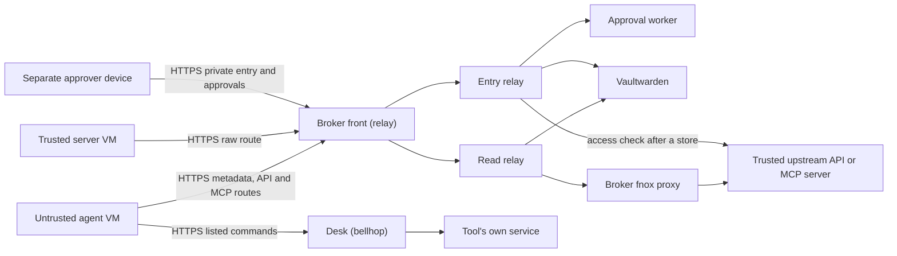

# valetkey threat model

## Summary

Machine-wide raw routes cannot keep keys unread by an agent that runs on an allowed machine.
valetkey therefore treats agent machines as broker-only, keeps raw values for separate trusted
consumers, and enforces that policy at the broker. The tests in this repository demonstrate the
tested boundaries with synthetic fixtures. They do not certify that keys can never be compromised
and say nothing about the state of any deployed broker.

## Scope and assumptions

- In scope: client tools/installer, broker route validation, read/front/entry HTTP services,
  Tailscale identity lookup, vault subprocess/cache boundaries, generated proxy policy, agent
  guidance and setup examples. Existing tests cover vault writes/rollback and request storage.
- Deployment is assumed to follow the dedicated broker architecture in `docs/architecture.md`,
  with broker-only agents and the machine separation in [secure setup](secure-setup.md).
- No real credentials, personal data, live broker/vault endpoints, private connectors or running
  service environments were accessed. Fixtures use isolated loopback and fake `bw`/Tailscale.
- Not established: actual deployed ACLs/roles, TLS termination, live fnox injection semantics,
  upstream behavior, vault grants, systemd configuration, swaps/dumps/backups or hypervisor safety.
- Not a full third-party dependency, release supply-chain, denial-of-service or cryptographic audit.
  One review pass is not exhaustive.

Questions every deployment has to answer: are agents already isolated from approver devices and trusted servers;
can any untrusted user rename/enroll/share a node into the broker's reachable set; do approved
upstreams expose reflection, secret-export or arbitrary forwarding operations? These determine
whether the remaining high-priority assumptions hold.

## System model

### Primary components

Python stdlib services provide TLS routing (`relay_front.py`), per-org reads/API forwarding
(`relay_read.py`) and owner entry (`relay_entry.py`). `relaylib/bwclient.py` wraps `bw` with values
on stdin rather than argv; it caches decrypted items in broker memory. Bash tools provision
systemd services and generate fnox policies. The `relay` client handles metadata, `vault` is a
raw-value shim for trusted servers, and `vault-entry` reads owner input. The entry page has
bundled JS/CSS and escaped server-rendered request descriptions.

### Data flows and trust boundaries

- Agent → broker front: HTTPS metadata/API requests; Tailscale peer identity, no client bearer
  token. The front overwrites peer headers and blocks internal endpoints (`relay_front.Handler`).
- Front → loopback services: HTTP with peer IP; service trust in the front and broker host.
  Duplicate lengths/transfer encoding are rejected (`relaylib/httpbase.py:61`).
- Read relay → vault subprocess/cache: per-org account, values in broker memory; errors exclude
  subprocess output (`relaylib/bwclient.py`, `broker/systemd/relay-{local,infra}.service`).
- API relay → fnox proxy → upstream: fixed HTTPS origin and permitted method/path; proxy injects
  the key. Responses stream back and remain a trusted confidentiality boundary
  (`relay_read.py:287`, `relay/tools/gen-fnox-config.py:generate`).
- Trusted server → raw endpoint: explicit trusted-node policy **and** route permission;
  declared agents denied (`relaylib/routes.py:80`, `relay_read.py:183`).
- Owner → entry → vault: private terminal/TLS form, untagged owner identity, HTML escaping/form
  token/CSP, per-write unlock and verification (`client/vault-entry`, `relay_entry.py:278`).
- Entry → upstream (access check): after a store, the new key goes only to the upstream of each
  `[api.*]` route that names that item, and an MCP handshake only to routes that look like MCP
  servers; no tool is run. Server text reaches the owner's page escaped, never an agent; agents get
  route names and counts only, and an echoed key is replaced (`relaylib/access_check.py`).
- Owner → approval worker: authenticator pairing at the console; route approvals with a code
  through the entry service's bounded operations (`approval_worker.py`).
- Agent → desk: listed commands only, run with the desk's own logins; the agent gets output, never
  the login (`bellhop/desk.py`).
- Operator → deployment: reviewed source and metadata policy; administration is trusted.
  CI/tests use synthetic secrets and do not prove production isolation (`.github/workflows/test.yml`).

#### Diagram

## Assets and security objectives

| Asset | Why it matters | Security objective |
|---|---|---|
| Provider credentials and backups | Access to upstream services | Confidentiality, integrity |
| Broker unlock/session material | Access to whole allowed collections | Confidentiality |
| Role, route and tailnet policy | Determines who can read, submit or use a key | Integrity |
| Owner input and pending requests | Key entry correctness; requests can be attacker-supplied | Confidentiality, integrity |
| Broker availability and audit trail | Consumer operation and incident investigation | Availability, integrity |

## Attacker model

### Capabilities

An agent can execute arbitrary client code, bypass shims, send raw HTTP, choose paths/headers/
bodies, create requests, and abuse allowed upstream operations. A compromised agent VM shares
its machine identity. An attacker can try prompt injection through request descriptions or API
responses. A malicious upstream can see the key it is given and can return it.

### Non-capabilities

Under the intended deployment, an agent cannot administer the broker/vault/hypervisor, read
trusted server memory, edit credential-bearing service code or policy, or capture owner input.
These are required isolation assumptions, not protections supplied by an instruction file.
Tailnet administration and upstream APIs are trusted; their compromise breaks the model.

## Entry points and attack surfaces

| Surface | How reached | Trust boundary | Notes | Evidence |
|---|---|---|---|---|
| Front HTTP paths/headers | Tailnet TCP 443 | Network to front/backend | Spoofing and framing controls | `relay_front.Handler`, `httpbase.RelayHandler` |
| Raw/notes/backup routes | Broker org paths | Agent to secret store | Default deny plus trusted-node and route checks | `relay_read.Handler.serve_value`, `.allowed` |
| API routes | Broker route path | Agent to privileged API | Canonical path, methods, fixed origin; semantic limits remain | `relay_read.Handler.api`, `routes.api_path_allowed` |
| Requests/status | Entry API | Agent to owner workflow | Names/purpose only; no value field in request state | `relay_entry.Handler.create`, `requests_store.py` |
| Entry UI and submission | Owner CLI/browser | Owner to vault write | Tagged/agent owners denied, hidden input, TLS, form token/CSP | `relay_entry.Handler`, `client/vault-entry` |
| Policy, installer, proxy generation | Operator CLI/files | Admin to enforcement | Operator-controlled names; no values belong here | `routes.load_routes`, `install.sh`, `gen-fnox-config.py` |

## Top abuse paths

1. Agent on a raw-authorized machine → direct `/value/` or project/notes/backup GET → key returned.
   **Confirmed original behavior; fixed for the selected model** with default-deny trusted-consumer
   gating and explicit agent-role exclusions. Removing the shim alone would not fix it.
2. Allowed API caller → percent-encoded dot/separator or sibling prefix → relay forwards a path
   outside the intended boundary. **Confirmed relay forwarding gap; fixed.** Pre-fix tests got
   502 from the attempted fake upstream connection rather than 403. Actual secret injection or
   credential theft through fnox/upstream was not demonstrated.
3. Tagged workload retains an owner-listed short name → owner entry accepted despite documented
   exclusion → credential integrity at risk. **Fixed** by retaining tag information in the identity
   cache and requiring an untagged, non-agent owner. Display names no longer override DNS names.
4. Owner CLI configured with remote HTTP, or hidden input unavailable → plaintext transmission
   or echo fallback. **Fixed** URL validation and input refusal; submission responses no longer
   echo arbitrary broker bodies. [Python documents the fallback behavior](https://docs.python.org/3.12/library/getpass.html).
5. Second replacement that day → delete dated backup → loss of the original credential/recovery
   path. **Confirmed source and former regression expectation; fixed** by refusing before mutation.
6. Agent reaches owner/trusted administration via broad ACL or shared host → captures memory or
   input → key theft. **Setup example corrected; live deployment unverified.** Broad member-to-
   member grants were removed; machine-separation guidance now makes this prerequisite explicit.
7. Agent calls approved reflection/secret-export API → upstream returns injected key → client
   reads it. **Residual design risk**, not demonstrated with an actual upstream. Exclude those APIs;
   generic response redaction cannot establish confidentiality.

## Threat model table

Priorities below describe the original weakness or remaining conditional threat, not an assertion
that a deployed system is exploitable.

| Threat ID | Threat source | Prerequisites | Threat action | Impact | Impacted assets | Existing controls (evidence) | Gaps | Recommended mitigations | Detection ideas | Likelihood | Impact severity | Priority |
|---|---|---|---|---|---|---|---|---|---|---|---|---|
| TM-001 | Agent code | Raw-authorized machine | Fetch raw/notes/backups directly | Scoped key theft | Provider keys | New `serve_value` policy | Trusted machine compromise remains | Separate consumers; no agent-controlled code there | Denied raw reads, role changes | High under old policy | High | high |
| TM-002 | Allowed API caller | Upstream normalizes paths | Encode traversal or extend prefix | Bypass relay path restriction | API capability | New `canonical_api_path` | Full upstream semantics unverified | Narrow paths, key scopes; validate real proxy with dummy keys | Path denials | Medium | Medium demonstrated | medium |
| TM-003 | Tagged service / renamed node | Owner/stale name grant | Acquire owner role | Unauthorized credential writes | Vault integrity | New `owner_machine`, role checks | Short names, not stable IDs | Restrict enrollment/rename/share; remove stale grants | Owner grants and node changes | Medium conditional | High | high |
| TM-004 | Network/local recorder | HTTP URL or echo failure | Observe submitted value | Scoped key disclosure | Owner-entered keys | URL validation, TTY and warning refusal | Compromised approver device still trusted | Separate private entry device | Failed entry transport/input | Medium conditional | High | high |
| TM-005 | Repeated owner replacement | Existing dated backup | Replace twice in a day | Original backup loss | Credential backup | `_write` collision refusal | Backup naming/rotation needs operator care | Retain backup; resolve collision privately | Refused replacement status | Medium | Medium | medium |
| TM-006 | Agent / host admin | Shared host or broad access | Read process memory or input | All reachable credentials | Keys, sessions | Separate topology; tightened ACL example | Live topology unverified | Isolate broker/vault/owner/consumer and management plane | Admin access, policy drift | High if co-located | High | high |
| TM-007 | Malicious/reflecting API | Allowed route discloses key | Return auth in response | Injected key theft | API key | Fixed destination and scope | Streaming response has no general redactor | Prohibit echo/export/forwarding routes; provider scopes | Reviewed endpoint inventory | Medium conditional | High | high |
| TM-008 | Runaway client | Broker reachability | Exhaust HTTP threads or request state | Availability loss | Service availability | Body caps, raw-read limiter | No comprehensive API/entry resource quota | Deployment limits; staged load tests | Connections, memory, request counts | Medium | Medium | medium |

## Criticality calibration

- Critical: unauthenticated vault-wide extraction or arbitrary broker code execution. Neither
  was demonstrated. A compromised trusted broker/root is explicitly outside the tested boundary.
- High: an agent reads its service key despite the unread-key requirement; a workload gains
  owner write privileges; co-located agents capture owner input.
- Medium: relay path policy bypass without demonstrated proxy injection; deletion of a dated
  backup; bounded availability weaknesses with no proven remote service-wide stop.
- Low: non-secret metadata disclosure or confusing status text without a demonstrated credential
  or authorization impact. Status language was clarified without claiming a key leak.

## Focus paths for security review

| Path | Why it matters | Related threats |
|---|---|---|
| `relay/relay_read.py:183` | Last raw-value enforcement point, including notes/backups | TM-001 |
| `relay/relaylib/routes.py:138` | Canonical path, origin and role validation | TM-001, TM-002 |
| `relay/tools/gen-fnox-config.py` | Exact endpoint and child-path proxy rules must match installed fnox semantics | TM-002, TM-007 |
| `relay/relaylib/identity.py:21` | Tagged owner exclusion and short-name identity assumption | TM-003 |
| `client/vault-entry:67` | Response masking, TLS URL validation, hidden input | TM-004 |
| `relay/relay_entry.py:232` | Backup preservation, owner checks and browser security | TM-003, TM-005 |
| `broker/systemd/`, `deploy/tailscale/acl.example.hujson:23` | Host isolation and network reachability | TM-006, TM-008 |
| `relay/relaylib/httpbase.py:61`, `relay/relaylib/requests_store.py` | HTTP framing, resource limits, persistent metadata | TM-008 |

## Verification and remaining work

The regression suite covers denial and successful trusted-consumer/API/owner workflows, spoofed headers,
cross-org access, notes/backups, duplicate lengths, transfer encoding, hidden input, URL checks,
no-secret responses/logs/argv, write verification/rollback and offline installed guidance.

Tests run via `bash relay/run-security-tests`: Linux bubblewrap, unshared network/PID/user/etc.
namespaces, only isolated loopback, empty allowlisted environment, synthetic localhost hosts file,
no host home, read-only source and `/usr`, 256 MiB temporary filesystem, 2 GiB address-space limit,
180 seconds CPU per process, 2048 per-user processes, 512 descriptors, 16 MiB file limit, no core
dumps, and 240 seconds wall time. No dependencies were fetched. Lint uses the same sandbox with
`--lint`.

Live validation remains operator-only: ACL/topology review, staged fnox injection with a dummy
upstream and synthetic key, real service authentication status without exposing values, secure
memory/storage policy and version/policy rollout. Follow [secure setup](secure-setup.md); do not
probe live raw-value endpoints from an agent or deploy without the migration procedure.

## Later hardening

Changes since the first review, each with a regression test:

- TM-003: a short name now counts only under the broker's own tailnet DNS suffix, so a device
  shared in from another tailnet cannot borrow an owner's or trusted server's name
  (`relaylib/identity.py`). Renamed or newly enrolled devices in the same tailnet remain an
  administration matter. After updating valetkey, confirm that known machines are still recognised
  (`relay check` from one of them).
- TM-008: one machine may hold at most 20 pending entry requests (429 beyond); the owner's
  listing and page name the machine that asked (`relay_entry.py`, `relaylib/requests_store.py`).
  API forwarding and connection counts are still unlimited.
- Audit lines are reduced to printable ASCII: control bytes in a request target made
  `journalctl` show the caller's own line as `[blob data]` (`relaylib/httpbase.py`).
- The entry page shows result text only when it carries this process's signature, so a link
  cannot put words in the page's own status box (`relay_entry.py`).
- The four service units refuse core dumps (`LimitCORE=0`) and gain standard sandboxing
  directives.

Left as is: any process on the broker host can name a caller to a loopback backend through
`X-Relay-Peer`, including one relay user towards the other org's relay. That stays inside the
"nothing else runs on the broker" assumption; closing it needs per-backend authentication of
the front door.

### Broker updates

`relay-update install` fetches the repository on the broker and runs its installer as root. The
boundary is the owner's `y` at the broker console after reviewing the shown commit: nothing
fetched is executed before it, and no network caller can start an install. Approval from the
entry page is deliberately not offered, because a compromised entry service combined with push
access would reach root. Remaining exposure: an owner who confirms without reviewing installs
whatever was pushed. A private repository adds a deploy key (read-only, one repository) as a new
secret on the broker; a public one is read over https and adds none.
